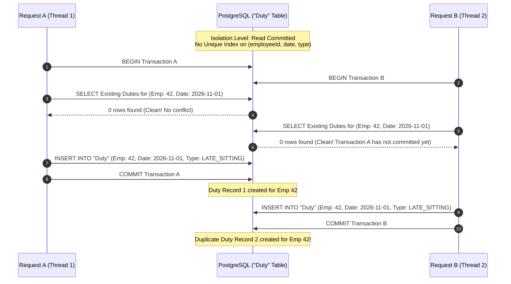

# Analysis of Duty Conflict Check vs Insert Race Condition

## ১. সারসংক্ষেপ (Executive Summary)

বর্তমানে [`duty.service.ts`](file:///d:/Late-Sitting-Holiday-Night-Duty/src/services/duty.service.ts) ফাইলে ডিউটি অ্যাসাইনমেন্ট বা সেভ করার সময় ডাটাবেস ট্রানজেকশন (`db.transaction(async (tx) => { ... })`) ব্যবহার করা হয়। ট্রানজেকশনের ভেতরে প্রথমে কনফ্লিক্ট চেক করা হয় (`DutyRepository.findExistingDuties(...)`) এবং কোনো দ্বন্দ্ব না থাকলে পরবর্তীতে `DutyRepository.createBulk(...)` এর মাধ্যমে নতুন রেকর্ড ইনসার্ট করা হয়।

তবে PostgreSQL-এর ডিফল্ট আইসোলেশন লেভেল **Read Committed**। এই আইসোলেশন লেভেলে কোনো ট্রানজেকশনের ভেতরে SELECT কুয়েরি কেবল ইতোমধ্যে কমিট হওয়া ডাটা দেখতে পায়। যদি ডাটাবেস টেবিলে **Unique Constraint / Unique Index** না থাকে, তবে একই সময়ে আসা দুটি রিকুয়েস্টের মধ্যে **Time-of-Check to Time-of-Use (TOCTOU) Race Condition** তৈরি হওয়া অনিবার্য।

---

## ২. রেস কন্ডিশনের মেকানিজম (Mechanism of Race Condition)

ধরা যাক, একই সাথে দুইজন অপারেটর বা একই ব্রাউজারের দুটি দ্রুত ক্লিকের মাধ্যমে একই কর্মকর্তা (`employeeId = 42`) ও একই তারিখ (`date = '2026-11-01'`) এর জন্য `LATE_SITTING` ডিউটি তৈরির রিকোয়েস্ট পাঠালো:

### কেন সাধারণ ট্রানজেকশন এটি ঠেকাতে পারে না?
1. **Read Committed Isolation**: ট্রানজেকশন B যখন SELECT চালায়, তখন ট্রানজেকশন A এখনও কমিট হয়নি। ফলে B কোনো কনফ্লিক্ট দেখতে পায় না।
2. **No Row Locks on Phantom Rows**: SELECT কুয়েরি কেবল বিদ্যমান রো-কে লক করতে পারে (`FOR UPDATE`)। যে রেকর্ডটি এখনও তৈরিই হয়নি (non-existent row), তার ওপর কোনো রো-লেভেল লক নেওয়া সম্ভব নয়।
3. **Transaction Serialization Failure**: যদি আইসোলেশন লেভেল `SERIALIZABLE` করাও হয়, তাহলেও কনকারেন্ট ইনসার্ট ব্যর্থ হয়ে এরর ছুঁড়বে, যা হ্যান্ডেল করা জটিল।

---

## ৩. সম্ভাব্য ক্ষতি ও ঝুঁকি (Risks & Impacts)

1. **ভুল বিল প্রস্তুত ও অতিরিক্ত অর্থ প্রদান (Financial Inaccuracy)**:
   - একই কর্মকর্তা একই দিনে দুইবার ডিউটি পেলে মাস শেষে বিল প্রস্তুত করার সময় duplicate allowance যোগ হয়ে মোট টাকার পরিমাণ ভুল হবে।
2. **অডিট আপত্তি (Audit Non-Compliance)**:
   - ব্যাংকিং পোর্টালে একই তারিখ ও একই ডিউটি টাইপের দ্বৈত এন্ট্রি অডিট ট্রেইলে মারাত্মক নন-কমপ্লায়েন্স হিসেবে গণ্য হয়।
3. **সিস্টেম স্টেট অসঙ্গতি (Data Inconsistency)**:
   - রোস্টার ক্যালেন্ডার বা এডিটর যখন একই দিনে দুটি এন্ট্রি পাবে, তখন UI স্টেট বা ডিলিট/আপডেট অ্যাকশনে অপ্রত্যাশিত ত্রুটি ঘটতে পারে।

---

## ৪. সমাধান ও প্রস্তাবিত প্রতিরোধমূলক ব্যবস্থা (Defensive Measures)

1. **ডাটাবেস লেভেলে ইউনিক ইনডেক্স (Canonical Defense)**:
   - [`docs/migrations-proposed/0001_duties_unique_index.sql`](file:///d:/Late-Sitting-Holiday-Night-Duty/docs/migrations-proposed/0001_duties_unique_index.sql) প্রয়োগ করা।
   - ডাটাবেস ইঞ্জিন লেভেলে `CREATE UNIQUE INDEX CONCURRENTLY` নিশ্চিত করে যে দ্বিতীয় ইনসার্টটি চলাকালীন ডাটাবেস ইউনিক ভায়োলেশন এরর (`23505: unique_violation`) প্রদান করবে এবং ট্রানজেকশন স্বয়ংক্রিয়ভাবে রোলব্যাক হবে।
2. **অ্যাপ্লিকেশন এরর হ্যান্ডলিং**:
   - `DutyRepository.createBulk` বা সার্ভিস লেভেলে কোড `23505` ক্যাচ করে ব্যবহারকারীকে সুন্দর বাংলায় উপযুক্ত বার্তা প্রদর্শন:
     `"একই তারিখে এই কর্মকর্তার জন্য ইতিমধ্যে ডিউটি সংরক্ষিত রয়েছে। অনুগ্রহ করে পৃষ্ঠাটি রিফ্রেশ করুন।"`
3. **প্রয়োজনে Advisory Lock**:
   - অতি জটিল ব্যাচ ইনসার্টের ক্ষেত্রে কর্মকর্তা ও তারিখের সমন্বয়ে PostgreSQL `pg_advisory_xact_lock(hashtext(...))` ব্যবহার করা যেতে পারে, তবে ইউনিক ইনডেক্সই ইন্ডাস্ট্রি স্ট্যান্ডার্ড ও সবচেয়ে কার্যকর গ্যারান্টি।
